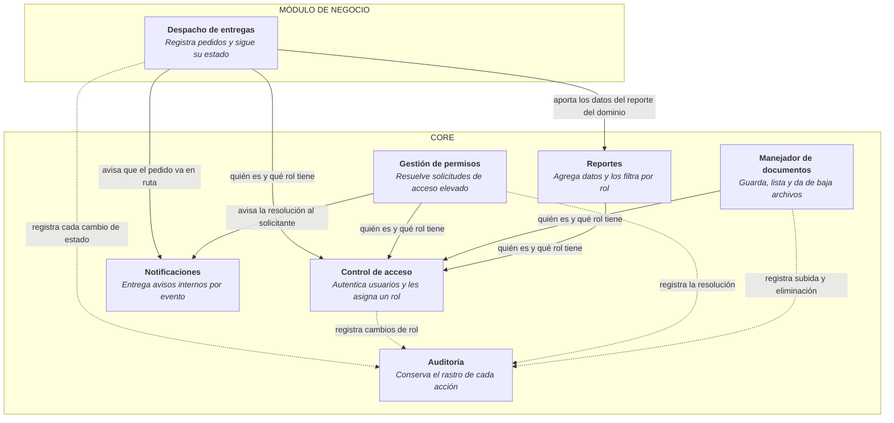
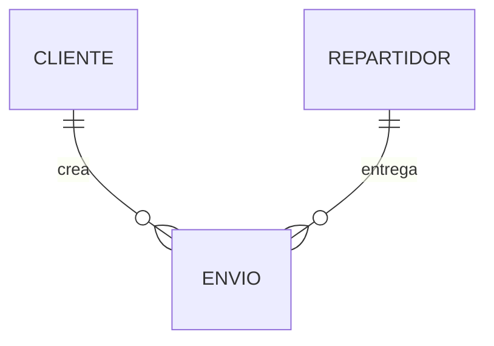
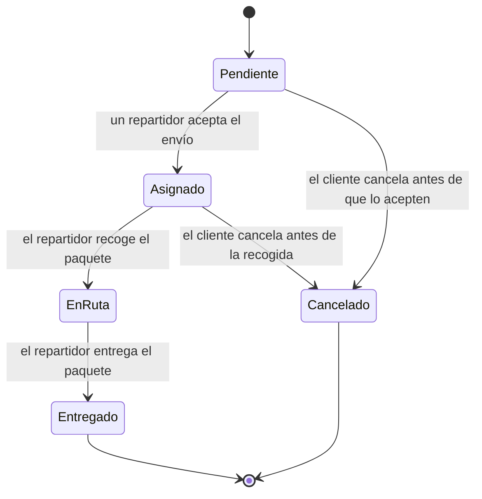

# Despacho de Entregas a Domicilio

Sistema de gestión de entregas para un servicio de reparto que opera
para varios comercios. Registra pedidos, los asigna a repartidores y
sigue el estado de cada entrega hasta su cierre.

Proyecto de **Programación III (TDS-007)** · ITLA · 2026-C-3 · Versión 0.1 · Prototipo en consola

---

## Tecnologías

- **Lenguaje:** C# / .NET 8
- **Base de datos:** SQL Server
- **ORM:** Entity Framework Core
- **Pruebas:** xUnit
- **Contenedores:** Docker (desde la semana 9)

---

## Arquitectura

El Core maneja los usuarios, las sesiones, los permisos y los correos. El módulo de negocio maneja los pedidos y sus entregas. Los pedidos usan el Core, pero el Core no depende de los pedidos (RD-03).

### Diagrama de componentes



Todas las piezas se construyen en C#. Las flechas punteadas van hacia
Auditoría: casi toda operación relevante deja rastro, y se dibujan
punteadas para no saturar el diagrama.

**Ninguna flecha sale del Core hacia el módulo de negocio.** El Core no
sabe que existen los pedidos (RD-03).

---

## Módulo de negocio

### Entidades

| Entidad | Responsabilidad |
|---|---|
| `Envio` | Traslado de un paquete de un punto a otro: modalidad, recogida, entrega, contacto, paquete, distancia, costo y estado |
| Cliente | Usuario Estándar que crea el envío (`ClienteId`) |
| Repartidor | Usuario Estándar con el permiso Repartidor aprobado (`RepartidorId`) |

### Relaciones



### Máquina de estados del Envío



- **Estado inicial:** `Pendiente`
- **Estados terminales:** `Entregado` y `Cancelado`. Ninguna transición parte de ellos (RF-NEG-05)
- **Transición prohibida explícita:** `Entregado → EnRuta`. El intento se rechaza y el estado no cambia (RF-NEG-04)
- Las transiciones se resuelven en un único punto del código (RD-04)

### Funcionalidades

1. Cotizar un envío antes de crearlo
2. Crear un envío, eligiendo si el cliente envía o recibe el paquete
3. Consultar mis envíos
4. Cancelar un envío
5. Ver los envíos disponibles (repartidor)
6. Aceptar un envío (repartidor con permiso aprobado)
7. Ver la ruta y las direcciones de los dos puntos (repartidor asignado)
8. Marcar el paquete como recogido y confirmar la entrega

---

## Estado del proyecto

| Pieza | Semanas | Estado |
|---|---|---|
| Diseño de componentes | 2 | Hecho |
| Control de acceso | 2–4 | Hecho |
| Gestión de permisos | 6–8 | Hecho |
| Módulo de negocio (envíos) | 8 | Hecho |
| Manejador de documentos y contenedor | 9 | Hecho |
| Notificaciones | 10–11 | Hecho |
| Reportes | 10–12 | Hecho |
| Auditoría | 12–14 | Pendiente |
| Interfaz web | 13 | Pendiente |

---

## Cómo ejecutar (Práctica 1)

### Requisitos

- .NET SDK 8
- SQL Server local (instancia por defecto, autenticación de Windows)
- Herramienta de EF Core: `dotnet tool install --global dotnet-ef --version 8.0.11`
- Una cuenta de Gmail con verificación en dos pasos y una contraseña de aplicación

### Variables de entorno

Nunca se guardan en el repositorio. En PowerShell se ponen con `$env:NOMBRE = "<valor>"` y duran mientras la terminal esté abierta.

| Variable | Para qué |
|---|---|
| `DESPACHO_CONEXION` | Cadena de conexión a SQL Server. La usan la Api y el EnviadorCorreos |
| `DESPACHO_URL_ACTIVACION` | Dirección base del enlace de activación (la del endpoint `GET /api/cuentas/activar`) |
| `DESPACHO_ADMIN_CORREO` | Correo de un usuario ya registrado que la Api convierte en Administrador al arrancar |
| `SMTP_HOST` | Servidor SMTP |
| `SMTP_PUERTO` | Puerto del servidor SMTP |
| `SMTP_USUARIO` | Cuenta que inicia sesión en el servidor SMTP |
| `SMTP_CONTRASENA` | Contraseña de aplicación de esa cuenta |
| `SMTP_REMITENTE` | Dirección que aparece como remitente |

### Pasos

1. Crear la base de datos (son dos partes, Core y Negocio):
   - `dotnet ef database update --context CoreDbContext --project src/Despacho.Core --startup-project src/Despacho.Api`
   - `dotnet ef database update --context NegocioDbContext --project src/Despacho.Negocio --startup-project src/Despacho.Api`
2. Arrancar la Api (queda en `https://localhost:7063`): `dotnet run --project src/Despacho.Api --launch-profile https`
3. En otra terminal, enviar los correos pendientes: `dotnet run --project src/Despacho.EnviadorCorreos`

Para las peticiones se usa `curl.exe` con el cuerpo en un archivo JSON, por ejemplo:

```
@{ correo = "<correo>"; contrasena = "Prueba123" } | ConvertTo-Json | Set-Content $env:TEMP\registro.json
curl.exe -k -X POST https://localhost:7063/api/cuentas/registro -H "Content-Type: application/json" --data "@$env:TEMP\registro.json"
```

Para guardar el token del inicio de sesión y usarlo en las demás peticiones:

```
$token = (curl.exe -k -s -X POST https://localhost:7063/api/sesion/iniciar -H "Content-Type: application/json" --data "@$env:TEMP\login.json" | ConvertFrom-Json).token
curl.exe -k https://localhost:7063/api/sesion/yo -H "Authorization: Bearer $token"
```

### Cómo probar cada criterio

| Criterio | Cómo provocarlo | Resultado esperado |
|---|---|---|
| RF-CA-01 correo único | Registrar dos veces el mismo correo | La segunda vez responde 400 "Ya existe una cuenta con ese correo." |
| RF-CA-02 hash con sal | Registrar dos correos con la misma contraseña y ver la tabla `Usuarios` | Los dos `HashContrasena` son distintos |
| RF-CA-14 contraseña | Registrar con menos de 8 caracteres, sin letras o sin números | Responde 400 con la regla de la contraseña |
| RF-CA-15 nace inactivo | Registrarse y ver la tabla `Usuarios` | `Activada` = 0 y hay un correo pendiente en `CorreosEnCola` |
| RF-CA-16 activación | Correr EnviadorCorreos y abrir el enlace del correo | "Cuenta activada". Abrirlo otra vez o con el token vencido (24 h) da error |
| RF-CA-17 reenvío | `POST /api/cuentas/reenviar-activacion` con un correo que exista y con uno que no | Mismo mensaje en los dos casos; el enlace anterior deja de servir |
| RF-NOT-08 cola | Registrarse con `SMTP_CONTRASENA` incorrecta o sin internet | El registro responde bien y el correo queda pendiente |
| RF-NOT-09 sin duplicar | Correr EnviadorCorreos dos veces seguidas | La segunda vez dice "Correos enviados: 0" |
| RF-CA-03 inicio de sesión | `POST /api/sesion/iniciar` con datos correctos y con datos incorrectos | Correctos: devuelve un `token`. Incorrectos: 401 "Correo o contraseña incorrectos." sin decir cuál falló |
| RF-CA-15 cuenta no activa | Iniciar sesión con una cuenta que no ha abierto el enlace | 401 "La cuenta no está activa. Revisa tu correo para activarla." |
| RF-CA-07 usuario autenticado | `GET /api/sesion/yo` con el encabezado `Authorization: Bearer <token>` | Devuelve id, correo y rol |
| RF-CA-18 cierre de sesión | `POST /api/sesion/cerrar` con el token y luego `GET /api/sesion/yo` con el mismo token | `/yo` responde 401 "Sesión no válida." |
| RF-CA-19 bloqueo | 5 inicios de sesión con contraseña incorrecta y luego uno con la correcta | El sexto se rechaza: cuenta bloqueada 15 minutos. Un inicio correcto antes del quinto fallo pone el contador en cero |
| RF-CA-04 roles | Arrancar la Api con `DESPACHO_ADMIN_CORREO` y llamar `/api/sesion/yo` con ese usuario | Su rol es Administrador; los demás nacen Estandar |
| RF-CA-21 listar usuarios | `GET /api/usuarios` con el token del Administrador | Lista con id, correo, rol y estado, sin hashes ni tokens |
| RF-CA-05 y RF-CA-06 un solo punto | `GET /api/usuarios` con el token de un Estandar | 403 "No tienes permiso para esta operación." (lo revisa el filtro `FiltroRol`) |
| RF-CA-08 cambio de rol | `PUT /api/usuarios/{id}/rol` con `{"rol":"Administrador"}`, primero con token Estandar y luego con token Administrador | Estandar: 403, ni siquiera sobre sí mismo. Administrador: "Rol actualizado." |
| RF-CA-20 desactivar | `POST /api/usuarios/{id}/desactivar` y luego `/api/sesion/yo` e inicio de sesión con ese usuario; también con el id del propio Administrador | La sesión deja de valer, no puede iniciar sesión y el Administrador no puede desactivarse a sí mismo. `POST /api/usuarios/{id}/reactivar` lo vuelve a habilitar |
| RF-CA-09 recuperación | `POST /api/contrasenas/recuperar` con `{"correo": ...}`, con un correo que existe y con uno que no | Mismo mensaje en los dos casos |
| RF-CA-10 código por la cola | Pedir recuperación y correr EnviadorCorreos | Llega un código de 6 dígitos que vence en 30 minutos; pedir otro invalida el anterior |
| RF-CA-11 y RF-CA-12 restablecer | `POST /api/contrasenas/restablecer` con `{"correo", "codigo", "contrasenaNueva"}` | La contraseña vieja deja de servir, la nueva funciona, las sesiones anteriores dan "Sesión no válida." y el mismo código no se puede usar otra vez |
| RF-CA-13 restablecimiento forzado | `POST /api/usuarios/{id}/forzar-restablecimiento` con token de Administrador y correr EnviadorCorreos | El usuario recibe un código por correo y sus sesiones se cierran |
| RF-CA-22 cambio con sesión | `POST /api/contrasenas/cambiar` con `{"contrasenaActual", "contrasenaNueva"}` y el token | Con la actual incorrecta da error; con la correcta cambia, aplica la regla de RF-CA-14 y cierra las sesiones |
| RD-04 máquina de estados | Ver `src/Despacho.Negocio/Pedidos`, la tabla `Pedidos` con su columna `Estado` y `docs/maquina-de-estados.md` | Tabla de transiciones, prohibida y terminales |

### Pendiente

Con la Api en modo Development (por ejemplo, en Docker), Swagger está en http://localhost:8080/swagger.

## Gestión de permisos (Asignación 2)

Un usuario Estándar solicita un permiso, y el permiso es un rol: pide ser Administrador. Estados de la solicitud: Pendiente → Aprobada → Aplicada, y Pendiente → Rechazada. Cualquier otra transición se rechaza y el estado no cambia. Las transiciones están en un solo lugar: `src/Despacho.Core/Permisos/TransicionesSolicitud.cs`. Al aprobar, el sistema cambia el rol del solicitante y deja la solicitud en Aplicada.

| Operación | Quién | Endpoint |
|---|---|---|
| Crear solicitud | Estándar | `POST /api/solicitudes` con `{"permiso":"Administrador"}` |
| Ver mis solicitudes | Cualquier usuario con sesión | `GET /api/solicitudes/mias` |
| Ver pendientes | Administrador | `GET /api/solicitudes/pendientes` |
| Aprobar | Administrador | `POST /api/solicitudes/{id}/aprobar` |
| Rechazar | Administrador | `POST /api/solicitudes/{id}/rechazar` con `{"motivo":"..."}` |

Todas usan el encabezado `Authorization: Bearer <token>` del inicio de sesión. Se necesitan dos usuarios: un Administrador (el de `DESPACHO_ADMIN_CORREO`) y un Estándar activado.

### Cómo provocar cada criterio

| Criterio | Cómo provocarlo | Resultado esperado |
|---|---|---|
| RF-GP-01 nace Pendiente | El Estándar crea una solicitud y consulta `GET /api/solicitudes/mias` | La solicitud aparece con estado `Pendiente` |
| RF-GP-02 consulta | El Administrador llama `GET /api/solicitudes/pendientes`; el Estándar llama el mismo endpoint | El Administrador ve las pendientes; el Estándar recibe 403 y en `/mias` solo ve las suyas |
| RF-GP-03 aprobar | El Administrador aprueba la solicitud y el Estándar consulta `/mias` | Estado `Aplicada`, con `aprobadorId` y `resueltaEnUtc` |
| RF-GP-04 rechazar con motivo | El Administrador rechaza una solicitud pendiente sin enviar `motivo`, y luego con `motivo` | Sin motivo: "Escribe el motivo del rechazo." y sigue `Pendiente`. Con motivo: estado `Rechazada` y `motivoRechazo` guardado |
| RF-GP-05 aplicación automática | Después de aprobar, el solicitante llama `GET /api/sesion/yo` con su mismo token | Su rol ya es `Administrador` y puede usar `GET /api/usuarios`, sin ningún paso manual |
| RF-GP-06 transiciones | Aprobar dos veces la misma solicitud, o aprobar una ya rechazada | "La solicitud no está pendiente." y el estado no cambia |
| RF-GP-07 propia solicitud | Un Estándar crea una solicitud; el Administrador le cambia el rol con `PUT /api/usuarios/{id}/rol` y `{"rol":"Administrador"}`; ese usuario intenta aprobar su propia solicitud pendiente | "No puedes resolver tu propia solicitud." y la solicitud sigue `Pendiente` |
| RD-09 persistencia | Reiniciar la Api y consultar `/mias` o `/pendientes` | Las solicitudes siguen ahí (SQL Server) |

## Pruebas

Desde la raíz de un clon limpio del repositorio, un solo comando ejecuta toda la suite. No necesita variables de entorno, ni SQL Server, ni la Api corriendo: las pruebas usan una base de datos en memoria y un reloj fijo.

```
dotnet test
```

La suite está en `tests/Despacho.Core.Tests`: las pruebas de la política de contraseña, de la entidad `SolicitudPermiso` (transiciones válidas y prohibidas) y del servicio de permisos (aprobar registra quién y cuándo, aplica el rol, aprobar dos veces se rechaza sin cambiar el estado, nadie resuelve su propia solicitud y el rechazo exige motivo).

El mismo comando ejecuta también `tests/Despacho.Negocio.Tests`: una prueba por cada fila de las tablas de transiciones permitidas y prohibidas de `docs/maquina-de-estados.md`, la prueba de que de los estados terminales no se sale, las pruebas del precio y del servicio de envíos y la prueba de integración con Gestión de permisos (`IntegracionPermisosEnviosTests`), que usa los componentes reales sin levantar la aplicación.

## Módulo de negocio: envíos

Despacho de Entregas funciona como un servicio de mensajería: un cliente pide que un repartidor recoja un paquete en un punto y lo lleve a otro. Al crear el envío, el cliente elige la modalidad:

- **Enviar:** la recogida es donde está el cliente, y el contacto es la persona que recibe el paquete.
- **Recibir:** la entrega es donde está el cliente, y el contacto es la persona que entrega el paquete.

Un repartidor es un usuario Estándar con el permiso **Repartidor** aprobado en Gestión de permisos: lo pide con `POST /api/solicitudes` y `{"permiso":"Repartidor"}`, y un Administrador lo aprueba con `POST /api/solicitudes/{id}/aprobar`. El repartidor no ve las direcciones exactas hasta que acepta el envío.

**Precio** (reglas en `src/Despacho.Negocio/Envios/TarifaEnvio.cs`): RD$ 100 incluye los primeros 2 km, más RD$ 20 por cada km extra; el tamaño multiplica (Pequeno ×1, Mediano ×1.25, Grande ×1.5). La distancia máxima es 30 km.

La máquina de estados está en `docs/maquina-de-estados.md`. Todas las operaciones usan `Authorization: Bearer <token>`.

Cuerpo para cotizar o crear un envío:

```
{"modalidad":"Enviar","origenLatitud":18.4861,"origenLongitud":-69.8571,"origenReferencia":"Casa azul","destinoLatitud":18.47,"destinoLongitud":-69.89,"destinoReferencia":"Oficina","contactoNombre":"Ana Perez","contactoTelefono":"809-555-1234","descripcionPaquete":"Documentos","tamano":"Mediano"}
```

### Apartado del cliente

| Operación | Quién | Endpoint | Cómo provocarla y resultado esperado |
|---|---|---|---|
| Cotizar | Estándar | `POST /api/envios/cotizacion` | Devuelve la distancia y el costo sin crear nada. A más de 30 km: "La distancia no puede pasar de 30 km." |
| Crear envío | Estándar | `POST /api/envios` | Devuelve su `id` y nace `Pendiente`. Con datos inválidos (mismo punto, sin contacto, modalidad o tamaño desconocidos): "Los datos del envío no son válidos." |
| Mis envíos | Estándar | `GET /api/envios/mios` | Solo los envíos de ese cliente |
| Todos los envíos | Administrador | `GET /api/envios` | Un Estándar recibe 403 |
| Cancelar | Cliente del envío o Administrador | `POST /api/envios/{id}/cancelar` | Desde `Pendiente` o `Asignado` queda `Cancelado`. Otro cliente: "Solo el cliente del envío o un Administrador pueden cancelarlo." En ruta o entregado: "El envío no puede cambiar a ese estado." |

### Apartado del repartidor

| Operación | Endpoint | Cómo provocarla y resultado esperado |
|---|---|---|
| Envíos disponibles | `GET /api/repartidor/envios-disponibles` | Sin el permiso aprobado: 403 "Necesitas el permiso Repartidor aprobado.". Con el permiso: los pendientes con tamaño, distancia y pago, sin direcciones |
| Aceptar | `POST /api/repartidor/envios/{id}/aceptar` | Sin el permiso aprobado se rechaza; después de la aprobación queda `Asignado`. Su propio envío: "No puedes aceptar tu propio envío." |
| Ver ruta | `GET /api/repartidor/envios/{id}/ruta` | Los dos puntos exactos, el contacto y el paquete. Cualquier otro usuario: "No puedes ver la ruta de este envío." |
| Ver direcciones | `GET /api/repartidor/envios/{id}/direcciones` | La dirección legible de la recogida y de la entrega (API externa, ver abajo) |
| Recoger | `POST /api/repartidor/envios/{id}/recoger` | Queda `EnRuta`. Otro repartidor: "No eres el repartidor de este envío." |
| Entregar | `POST /api/repartidor/envios/{id}/entregar` | Queda `Entregado`. Si todavía está `Asignado`: "El envío no puede cambiar a ese estado." |

## Defectos

### Práctica 2

Práctica 2, variante A (matrícula 2025-1963). Cada defecto está en un commit cuyo padre es `practica-2`, con la etiqueta `practica-2-defecto-N`. Sobre cada etiqueta, `dotnet test` falla en al menos la prueba indicada; sobre `practica-2` todas pasan.

| Defecto | Requisito | Prueba que lo detecta | Comportamiento que comprueba |
|---|---|---|---|
| 1 | RF-GP-06 | `AprobarAsync_SolicitudYaAprobada_SeRechazaYElEstadoNoCambia` | Aprobar una solicitud ya aplicada se rechaza, sigue `Aplicada` y conserva su aprobador |
| 2 | RF-GP-06 | `MarcarAplicada_SolicitudRechazada_SeRechazaYElEstadoNoCambia` y `TransicionesSolicitud_FueraDeLaTabla_NoEstaPermitida(Rechazada, Aplicada)` | Una solicitud rechazada no puede pasar a `Aplicada` |
| 3 | RF-GP-07 | `AprobarAsync_SolicitudPropia_SeRechazaYElEstadoNoCambia` y `RechazarAsync_SolicitudPropia_SeRechazaYElEstadoNoCambia` | Nadie aprueba ni rechaza su propia solicitud; sigue `Pendiente` |
| 4 | RF-GP-02 | `ListarDeUsuarioAsync_ConSolicitudesDeOtros_SoloDevuelveLasPropias` | La consulta de un Estándar devuelve solo sus solicitudes |
| 5 | RF-GP-06 | `TransicionesSolicitud_FueraDeLaTabla_NoEstaPermitida(Aprobada, Pendiente)` | Una solicitud aprobada no puede volver a `Pendiente` |
| 6 | RF-GP-04 | `RechazarAsync_ConMotivo_RegistraMotivoYFecha` | Al rechazar se guarda el motivo escrito |

### Práctica 3

Estos defectos se plantaron sobre la versión del negocio con pedidos (etiqueta `practica-3`); después el negocio pasó a envíos.

Cada defecto está en un commit cuyo padre es `practica-3`, con la etiqueta `practica-3-defecto-N`. Sobre cada etiqueta, `dotnet test` falla en al menos la prueba indicada; sobre `practica-3` todas pasan.

| Defecto | Qué se planta | Prueba que lo detecta | Comportamiento que comprueba |
|---|---|---|---|
| 1 | La primera prohibida (Pendiente → EnRuta) pasa a permitida | `CambiarEstado_TransicionProhibida_SeRechazaYElEstadoNoCambia(Pendiente, EnRuta)` | Un pedido pendiente no puede pasar directo a `EnRuta` |
| 2 | Una transición que parte del terminal `Cancelado` | `EstadoTerminal_NingunaTransicionParteDeEl(Cancelado)` | Ninguna transición parte de un estado terminal |
| 3 | Se elimina la condición de cancelar (solo el cliente del pedido o un Administrador) | `CancelarAsync_PorOtroCliente_SeRechazaYElEstadoNoCambia` | Otro cliente no puede cancelar y el pedido sigue `Pendiente` |
| 4 | Se elimina la consulta a Gestión de permisos al aceptar | `AceptarAsync_ConSolicitudSinAprobar_SeRechazaYElPedidoSiguePendiente` | Sin el permiso Repartidor aprobado no se acepta el pedido |

## Contenedor

Solo hace falta Docker (con Docker Desktop encendido). Desde la raíz de un clon limpio:

1. Copia el archivo de ejemplo de variables:
   - Windows (PowerShell): `Copy-Item .env.example .env`
   - Linux o macOS: `cp .env.example .env`
2. Levanta todo con un solo comando:

```
docker compose up --build
```

La Api responde en **http://localhost:8080** (Swagger en http://localhost:8080/swagger). La base de datos y todas sus tablas se crean solas al arrancar; no hay que ejecutar migraciones a mano.

| Servicio | Qué es | Puerto |
|---|---|---|
| `api` | La Api | 8080 (el único publicado) |
| `db` | SQL Server 2022 | No se publica; la Api lo encuentra por el nombre `db` |
| `enviador` | Envía los correos de la cola cada 30 segundos | No publica |

Los datos sobreviven en dos volúmenes con nombre: `datos-sql` (la base de datos) y `documentos` (los archivos subidos).

Para detener el proyecto: `Ctrl + C` en la terminal donde corre, o `docker compose down` desde otra terminal. `docker compose down` borra los contenedores pero conserva los volúmenes: al volver a levantar, los usuarios y los documentos siguen ahí. (`docker compose down -v` sí borra los datos.)

**Correos:** con los valores de ejemplo del `.env`, los correos quedan en la cola pero no salen. Para que lleguen, pon en `.env` una cuenta de Gmail con su contraseña de aplicación (`SMTP_USUARIO`, `SMTP_CONTRASENA`, `SMTP_REMITENTE`). Sin correo real, el token de activación se puede leer de la base:

```
docker compose exec db /opt/mssql-tools18/bin/sqlcmd -S localhost -U sa -P "Ejemplo_Clave123!" -C -d DespachoEntregas -h -1 -W -Q "SELECT TOP 1 t.Token FROM TokensActivacion t JOIN Usuarios u ON u.Id = t.UsuarioId WHERE u.Correo = 'CORREO' ORDER BY t.Id DESC"
```

y la cuenta se activa abriendo `http://localhost:8080/api/cuentas/activar?token=TOKEN`.

**Administrador inicial:** registra y activa la cuenta cuyo correo está en `DESPACHO_ADMIN_CORREO` del `.env`, y luego ejecuta `docker compose restart api`. Al arrancar, la Api convierte esa cuenta en Administrador.

## Manejador de documentos

Todas las operaciones requieren sesión (`Authorization: Bearer <token>`).

| Operación | Endpoint | Resultado esperado |
|---|---|---|
| Subir | `POST /api/documentos` con un formulario multipart y el campo `archivo` | Guarda nombre, tipo, tamaño, fecha y dueño. Un archivo ausente o vacío: "Selecciona un archivo que no esté vacío." |
| Listar | `GET /api/documentos` | Solo los documentos propios y no eliminados; el Administrador ve los de todos |
| Descargar | `GET /api/documentos/{id}/descargar` | El dueño o un Administrador lo descargan; otro usuario recibe 403 |
| Eliminar | `DELETE /api/documentos/{id}` | Eliminación lógica: deja de aparecer en el listado, pero el registro sigue en la base con `Eliminado = 1`. Otro usuario recibe 403 |

Ejemplo para subir con curl:

```
curl -X POST http://localhost:8080/api/documentos -H "Authorization: Bearer TOKEN" -F "archivo=@guia.txt;type=text/plain"
```

## API externa

**API:** OpenCage Geocoding (geocodificación inversa): convierte una latitud y longitud en una dirección legible.

**Operación que la usa:** `GET /api/repartidor/envios/{id}/direcciones`. Solo el repartidor asignado al envío la puede usar, cuando el envío está `Asignado` o `EnRuta`. Toma el punto de recogida y el punto de entrega guardados en el envío y devuelve la dirección legible de cada uno, para que el repartidor sepa a dónde ir.

**Variable:** `OPENCAGE_API_KEY`, en el archivo `.env`, que no se versiona. La clave no está en el código, en el `Dockerfile`, en el `docker-compose.yml` ni en ningún commit. La clave gratuita se obtiene en https://opencagedata.com.

**Ejemplo real de respuesta** (recogida en latitud 18.4861 y longitud -69.8571; entrega en latitud 18.47 y longitud -69.89):

```
{"direccionOrigen":"Calle 1A, Jardines de Alma Rosa, Santo Domingo Este, Santo Domingo, 03006, República Dominicana","direccionDestino":"Calle Padre Billini 411, Ciudad Nueva, Santo Domingo de Guzmán, DN, 10208, República Dominicana"}
```

**Sin clave o con la API caída:** la operación responde `503` con un mensaje claro ("El servicio de direcciones no está configurado." o "El servicio de direcciones no está disponible. Intenta más tarde.") y el resto del proyecto sigue funcionando. Con la clave de ejemplo del `.env.example`, la respuesta es la segunda.

## Notificaciones

Cada notificación llega por dos canales: dentro del sistema y por correo. El correo se encola y lo envía el servicio `enviador` (ver más abajo). Todas las operaciones usan `Authorization: Bearer <token>`.

| Evento | Quién recibe | Cómo provocarlo |
|---|---|---|
| Se crea una solicitud de permiso | Todos los Administradores activos | Un Estándar llama `POST /api/solicitudes` con `{"permiso":"Repartidor"}` |
| Se aprueba una solicitud | El solicitante | Un Administrador llama `POST /api/solicitudes/{id}/aprobar` |
| Se rechaza una solicitud | El solicitante, con el motivo | Un Administrador llama `POST /api/solicitudes/{id}/rechazar` con `{"motivo":"..."}` |
| Un repartidor acepta un envío (evento del negocio) | El cliente del envío | Con el permiso Repartidor aprobado, `POST /api/repartidor/envios/{id}/aceptar` |
| Un repartidor entrega un envío (evento del negocio) | El cliente del envío | `POST /api/repartidor/envios/{id}/recoger` y luego `POST /api/repartidor/envios/{id}/entregar` |

| Operación | Endpoint | Resultado esperado |
|---|---|---|
| Mis notificaciones | `GET /api/notificaciones` | Solo las propias, de la más nueva a la más vieja, cada una con `leida` |
| Solo las no leídas | `GET /api/notificaciones?soloNoLeidas=true` | Solo las propias sin leer |
| Marcar como leída | `POST /api/notificaciones/{id}/leida` | La propia queda leída. La de otro usuario responde 404 |
| Apagar o encender el correo | `PUT /api/notificaciones/preferencias` con `{"correo":false}` o `{"correo":true}` | Con el correo apagado, la notificación interna sigue llegando y no se encola ningún correo |

### Cola de correos

Los correos se guardan en la cola dentro de la misma operación y nunca se envían ahí: la operación termina bien aunque el servidor de correo no responda.

- **El procesador** es el servicio `enviador` de `docker-compose.yml`, que corre solo cada 30 segundos. Para correrlo una vez a mano: `docker compose exec enviador dotnet /app/enviador/Despacho.EnviadorCorreos.dll`
- **Máximo de intentos: 3.** Cada fallo suma un intento y guarda el último error. Al tercer fallo el correo queda `Fallido` y no se vuelve a intentar. Ningún correo se borra. El valor está en `CorreoEnCola.MaximoIntentos`.
- Un correo `Enviado` no se vuelve a enviar: correr el procesador dos veces seguidas no duplica nada.
- **Consultar la cola** (solo Administrador): `GET /api/correos`, o filtrando por estado con `GET /api/correos?estado=Pendiente`, `Enviado` o `Fallido`. Muestra destinatario, asunto, estado, intentos, fechas y último error. Un Estándar recibe 403.
- **Provocar un fallo de envío:** en `.env` cambia `SMTP_HOST` por `no-existe.invalid`, ejecuta `docker compose up -d --force-recreate enviador` y provoca cualquier evento. En la cola verás el correo sumar intentos hasta quedar `Fallido` con su último error. Para volver a la normalidad, restaura `SMTP_HOST` y repite el comando.
- Las credenciales del servidor de correo (`SMTP_HOST`, `SMTP_PUERTO`, `SMTP_USUARIO`, `SMTP_CONTRASENA`, `SMTP_REMITENTE`) se leen de variables de entorno, desde el `.env`, que no se versiona.

## Reportes

Los dos reportes devuelven valores agrupados (no el listado de registros), calculados en la base de datos. Se filtran por fechas con `desde` y `hasta` en formato `AAAA-MM-DD`, en UTC, con el día `hasta` incluido completo. Si `desde` es posterior a `hasta` o una fecha no existe, responden 400. Un rango sin datos devuelve una lista vacía.

| Reporte | Endpoint | Qué devuelve |
|---|---|---|
| Solicitudes de permiso por estado (Core) | `GET /api/reportes/solicitudes?desde=2026-11-01&hasta=2026-11-30` | Una fila por estado con su cantidad |
| Lo que hizo cada repartidor (negocio) | `GET /api/reportes/repartidores?desde=2026-11-01&hasta=2026-11-30` | Una fila por repartidor con los envíos entregados, los kilómetros y lo que generó, de mayor a menor |

**Pregunta que responde el reporte del negocio:** ¿cuántos envíos entregó cada repartidor, cuántos kilómetros recorrió y cuánto dinero generó en un período?

**Según el rol:** el Administrador ve los datos de todos. Un Estándar ve solo lo suyo: en el de solicitudes, las que él creó; en el de repartidores, solo su propia fila.

## Auditoría

Cada cambio importante deja un registro en el historial, guardado en la misma operación que el cambio: se guardan los dos o ninguno. Cada registro tiene `id`, `usuarioId` (quién actuó), `accion`, `entidad` (`SolicitudPermiso`, `Documento` o `Usuario`), `entidadId`, `fechaUtc` (en UTC), `valorAnterior` y `valorNuevo`. Ningún campo viene vacío. Nunca se guardan contraseñas, hashes ni códigos.

| Evento | Acción registrada | Valor anterior → valor nuevo |
|---|---|---|
| Aprobar una solicitud | `AprobarSolicitud` | `Pendiente` → `Aplicada` |
| Rechazar una solicitud | `RechazarSolicitud` | `Pendiente` → `Rechazada: <motivo>` |
| Subir un documento | `SubirDocumento` | `(no existía)` → nombre del archivo |
| Eliminar un documento | `EliminarDocumento` | nombre del archivo → `(eliminado)` |
| Cambiar el rol | `CambiarRol` | `Estandar` → `Administrador` (o al revés) |
| Desactivar un usuario | `DesactivarUsuario` | `Activo` → `Desactivado` |
| Reactivar un usuario | `ReactivarUsuario` | `Desactivado` → `Activo` |
| Forzar un restablecimiento | `ForzarRestablecimiento` | `Contraseña vigente` → `Código de restablecimiento enviado` |
| Restablecer la contraseña | `RestablecerContrasena` | `Contraseña anterior` → `Contraseña restablecida (iniciado por el propio usuario)` o `(iniciado por un Administrador)` |

### Preparación

Se necesitan un Administrador (el de `DESPACHO_ADMIN_CORREO`) y un Estándar activado, con la Api en http://localhost:8080. Los comandos son para PowerShell y usan `curl.exe`. Cambia los correos y las contraseñas por los tuyos.

```
$base = "http://localhost:8080"

function Json($objeto) {
    $archivo = New-TemporaryFile
    ($objeto | ConvertTo-Json -Compress) | Set-Content $archivo -Encoding ascii
    "@$archivo"
}

function Entrar($correo, $contrasena) {
    (curl.exe -s -X POST "$base/api/sesion/iniciar" -H "Content-Type: application/json" --data (Json @{ correo = $correo; contrasena = $contrasena }) | ConvertFrom-Json).token
}

$tokenA = Entrar "admin@ejemplo.com" "ClaveAdmin123"
$tokenR = Entrar "r@ejemplo.com" "ClaveR12345"

$usuarios = curl.exe -s "$base/api/usuarios" -H "Authorization: Bearer $tokenA" | ConvertFrom-Json
$idR = ($usuarios | Where-Object { $_.correo -eq "r@ejemplo.com" }).id
```

### Cómo provocar cada evento

**Rechazar una solicitud.** R pide un permiso y el Administrador lo rechaza con motivo:

```
$s = curl.exe -s -X POST "$base/api/solicitudes" -H "Authorization: Bearer $tokenR" -H "Content-Type: application/json" --data (Json @{ permiso = "Administrador" }) | ConvertFrom-Json
curl.exe -s -X POST "$base/api/solicitudes/$($s.id)/rechazar" -H "Authorization: Bearer $tokenA" -H "Content-Type: application/json" --data (Json @{ motivo = "Falta la licencia" })
```

**Aprobar una solicitud.** Igual, pero con el permiso Repartidor:

```
$s = curl.exe -s -X POST "$base/api/solicitudes" -H "Authorization: Bearer $tokenR" -H "Content-Type: application/json" --data (Json @{ permiso = "Repartidor" }) | ConvertFrom-Json
curl.exe -s -X POST "$base/api/solicitudes/$($s.id)/aprobar" -H "Authorization: Bearer $tokenA"
```

**Subir y eliminar un documento.** Lo hace R (o el Administrador para eliminar):

```
Set-Content licencia.pdf "contenido de prueba"
$d = curl.exe -s -X POST "$base/api/documentos" -H "Authorization: Bearer $tokenR" -F "archivo=@licencia.pdf;type=application/pdf" | ConvertFrom-Json
curl.exe -s -X DELETE "$base/api/documentos/$($d.id)" -H "Authorization: Bearer $tokenR"
```

**Cambiar un rol.** Lo hace el Administrador; el segundo comando devuelve a R a Estándar y deja otro registro:

```
curl.exe -s -X PUT "$base/api/usuarios/$idR/rol" -H "Authorization: Bearer $tokenA" -H "Content-Type: application/json" --data (Json @{ rol = "Administrador" })
curl.exe -s -X PUT "$base/api/usuarios/$idR/rol" -H "Authorization: Bearer $tokenA" -H "Content-Type: application/json" --data (Json @{ rol = "Estandar" })
```

**Desactivar y reactivar un usuario.** Al desactivar, las sesiones de R se cierran; después de reactivar, R inicia sesión de nuevo:

```
curl.exe -s -X POST "$base/api/usuarios/$idR/desactivar" -H "Authorization: Bearer $tokenA"
curl.exe -s -X POST "$base/api/usuarios/$idR/reactivar" -H "Authorization: Bearer $tokenA"
$tokenR = Entrar "r@ejemplo.com" "ClaveR12345"
```

**Restablecer la contraseña como el propio usuario.** R pide un código; llega por correo. Sin correo real, se lee de la base (cambia `<CLAVE_SA>` por la clave `sa` de tu `.env`):

```
curl.exe -s -X POST "$base/api/contrasenas/recuperar" -H "Content-Type: application/json" --data (Json @{ correo = "r@ejemplo.com" })
docker compose exec db /opt/mssql-tools18/bin/sqlcmd -S localhost -U sa -P "<CLAVE_SA>" -C -d DespachoEntregas -h -1 -W -Q "SELECT TOP 1 c.Codigo FROM CodigosRecuperacion c JOIN Usuarios u ON u.Id = c.UsuarioId WHERE u.Correo = 'r@ejemplo.com' ORDER BY c.Id DESC"
curl.exe -s -X POST "$base/api/contrasenas/restablecer" -H "Content-Type: application/json" --data (Json @{ correo = "r@ejemplo.com"; codigo = "123456"; contrasenaNueva = "ClaveNueva123" })
```

Cambia `123456` por el código que leíste. Queda el registro `RestablecerContrasena` con `(iniciado por el propio usuario)`.

**Forzar un restablecimiento como Administrador.** El Administrador fuerza el cambio; R usa el código que le llega:

```
curl.exe -s -X POST "$base/api/usuarios/$idR/forzar-restablecimiento" -H "Authorization: Bearer $tokenA"
docker compose exec db /opt/mssql-tools18/bin/sqlcmd -S localhost -U sa -P "<CLAVE_SA>" -C -d DespachoEntregas -h -1 -W -Q "SELECT TOP 1 c.Codigo FROM CodigosRecuperacion c JOIN Usuarios u ON u.Id = c.UsuarioId WHERE u.Correo = 'r@ejemplo.com' ORDER BY c.Id DESC"
curl.exe -s -X POST "$base/api/contrasenas/restablecer" -H "Content-Type: application/json" --data (Json @{ correo = "r@ejemplo.com"; codigo = "123456"; contrasenaNueva = "ClaveOtra123" })
```

Quedan dos registros: `ForzarRestablecimiento` (del Administrador) y `RestablecerContrasena` con `(iniciado por un Administrador)` (de R).

### Cómo consultar el historial

Solo el Administrador consulta: `GET /api/auditoria`. Todos los filtros son opcionales y se pueden combinar. Los resultados salen del más nuevo al más viejo. Las fechas son `AAAA-MM-DD`, en UTC, y el día `hasta` se incluye completo.

```
curl.exe -s "$base/api/auditoria" -H "Authorization: Bearer $tokenA"
curl.exe -s "$base/api/auditoria?usuarioId=$idR" -H "Authorization: Bearer $tokenA"
curl.exe -s "$base/api/auditoria?entidad=Documento" -H "Authorization: Bearer $tokenA"
curl.exe -s "$base/api/auditoria?desde=2026-11-20&hasta=2026-11-20" -H "Authorization: Bearer $tokenA"
curl.exe -s "$base/api/auditoria?usuarioId=$idR&entidad=Usuario&desde=2026-11-01&hasta=2026-11-30" -H "Authorization: Bearer $tokenA"
```

| Petición | Respuesta |
|---|---|
| Sin token | 401 |
| Con el token de un Estándar | 403 |
| `usuarioId=abc`, `entidad=Envio`, `desde=2026-13-40` o `desde` posterior a `hasta` | 400 con un mensaje claro |
| Un filtro sin coincidencias | 200 con una lista vacía |

### El historial no se edita ni se borra

No existe ningún endpoint `PUT`, `PATCH` ni `DELETE` sobre `/api/auditoria`, el servicio de auditoría solo tiene el método de consulta, y `CoreDbContext` lanza una excepción y no guarda nada si algún código intenta modificar o borrar un registro.

El historial vive en la base de datos, en el volumen `datos-sql`. Sobrevive a `docker compose down` (sin `-v`): al volver a ejecutar `docker compose up`, los registros siguen ahí. Solo `docker compose down -v` los borra, junto con el resto de los datos.
