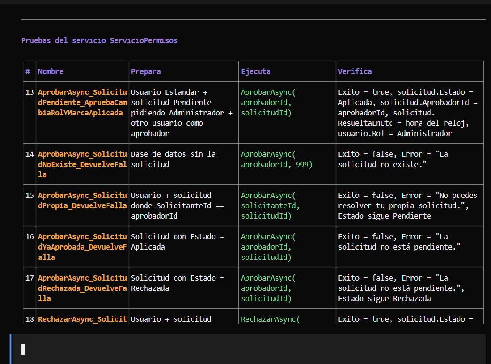
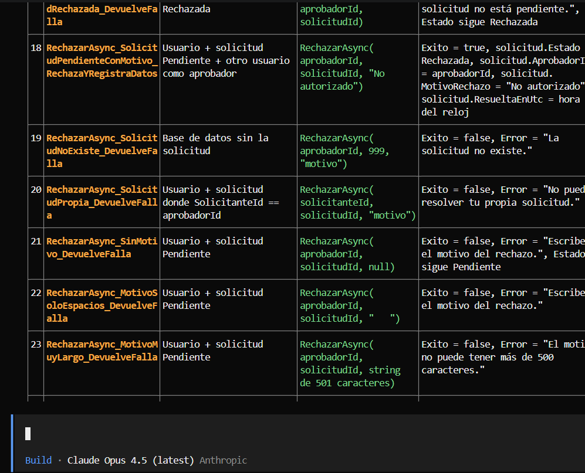
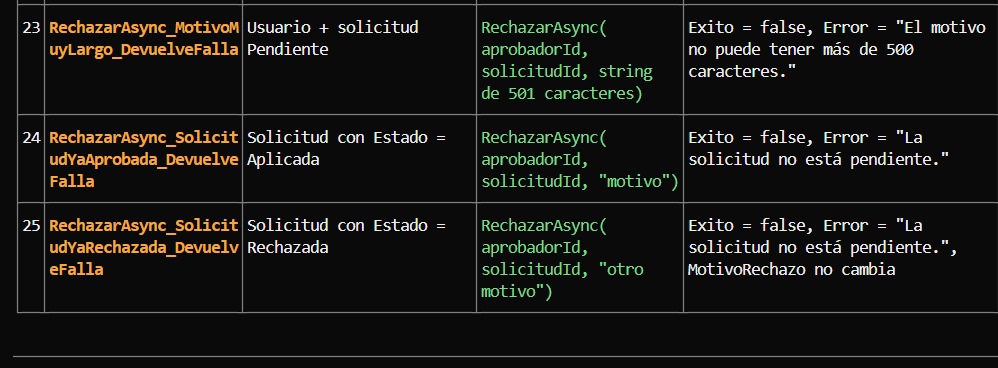

# Bitácora — Asignación 2: Gestión de permisos

**Agente:** OpenCode con Claude (Sonnet 4.5; en una sesión quedó Opus 4.5 sin que yo lo eligiera).
**Fechas:** 19 y 20 de octubre de 2026.

## Tareas que le delegué

| Tarea | Qué le pedí | Qué devolvió | Cómo lo revisé |
|---|---|---|---|
| Construir la entidad | Los estados, la tabla de transiciones en un solo lugar y `SolicitudPermiso` con estado `private set` | Los 3 archivos tal como los pedí | `git status -u`, `dotnet build` y lectura del código |
| Construir el servicio | `ServicioPermisos` usando solo los métodos de la entidad, sin revisar el estado por su cuenta | El servicio correcto | Lectura del código y `Select-String` para un mensaje que la terminal mostraba cortado |
| Construir los endpoints | Cinco endpoints con su filtro de rol | Los endpoints, cada uno con su filtro | `git diff` y lectura del código |
| **Proponer los casos de prueba** | Casos para RF-GP-03 a RF-GP-07, sin escribir código | 25 casos | **Aquí se equivocó** (abajo) |

## El caso en que se equivocó

**Qué le pedí:** que leyera `SolicitudPermiso.cs` y `ServicioPermisos.cs` y propusiera casos de prueba para RF-GP-03 a RF-GP-07, indicando qué prepara, qué ejecuta y qué verifica cada uno.

**Qué devolvió:** 25 casos. Evidencia:

**Error 1 — preparación imposible.** En los casos 16, 17, 24 y 25 (y en 2, 3, 4, 7 y 11) proponía preparar "una solicitud con Estado = Aplicada" o "Rechazada". Pero en `SolicitudPermiso` el `Estado` tiene `private set`: no se puede asignar desde afuera. Escrita así, la prueba no compila.

**Error 2 — la prueba clave no verificaba el estado.** El caso 16 (aprobar una solicitud ya aprobada) es justo el de RF-GP-06, que exige que se rechace **y que el estado no cambie**. Solo verificaba `Exito = false` y el mensaje. Los casos 20 y 24 tenían el mismo problema.

**Detalle adicional:** el caso 13 verificaba dos comportamientos en una sola prueba (lo que registra la aprobación y el cambio de rol).

**Cómo lo detecté:** comparé su lista con el código de `SolicitudPermiso.cs` (donde vi el `private set`) y con el criterio de RF-GP-06 y la rúbrica (que pide verificar que el estado no cambió).

**Cómo lo corregí:** le señalé los dos errores y le pedí solo 9 pruebas concretas: llegar a cada estado por el camino real (`Aprobar`, `MarcarAplicada`, `Rechazar`), verificar el rechazo **y** el estado en las transiciones prohibidas, y separar la aprobación del cambio de rol. Revisé el código que escribió: la prueba `AprobarAsync_SolicitudYaAprobada_SeRechazaYElEstadoNoCambia` ahora verifica el rechazo, que sigue `Aplicada` y que el aprobador sigue siendo el primero. Resultado de `dotnet test`: 12 de 12 correctas.

## Lo que aprendí

Que una prueba pase no significa que pruebe lo correcto. Hay que leer qué prepara, qué ejecuta y qué verifica, y compararlo con el requisito.